# Context Agent — Technical Report & Approach Document

**Version:** 2.0
**Status:** Current as of the `v2` branch
**Supersedes:** `Context_Agent_Approach_Document.md` (v1)
**Scope:** Complete technical description of the Context Agent system — the problem it solves, the approach taken, the three operating modes, every subsystem, and an honest assessment of what is implemented versus what is documented.

---

## Table of Contents

**Part I — Problem & Approach**
1. [Executive Summary](#1-executive-summary)
2. [Problem Statement](#2-problem-statement)
3. [Solution Thesis and Design Principles](#3-solution-thesis-and-design-principles)
4. [System Architecture](#4-system-architecture)

**Part II — The Three Operating Modes**

5. [Mode Framework Overview](#5-mode-framework-overview)
6. [Mode A — Build From Scratch](#6-mode-a--build-from-scratch)
7. [Mode B — Ingest Existing Codebase](#7-mode-b--ingest-existing-codebase)
8. [Mode C — Documents](#8-mode-c--documents)
9. [Cross-Mode Comparison and Composition](#9-cross-mode-comparison-and-composition)

**Part III — Subsystem Reference**

10. [The Project Brain](#10-the-project-brain)
11. [The Planning Engine](#11-the-planning-engine)
12. [The Context Retrieval Engine](#12-the-context-retrieval-engine)
13. [Code Generation Pipeline](#13-code-generation-pipeline)
14. [Verification and Self-Healing](#14-verification-and-self-healing)
15. [The QA Agent](#15-the-qa-agent)
16. [The LLM Client](#16-the-llm-client)
17. [Communication Layer](#17-communication-layer)
18. [Frontend](#18-frontend)
19. [Security and Sandboxing](#19-security-and-sandboxing)
20. [Persistence, Checkpointing and Resumability](#20-persistence-checkpointing-and-resumability)

**Part IV — Reference and Assessment**

21. [Configuration Reference](#21-configuration-reference)
22. [Data Model Reference](#22-data-model-reference)
23. [Technology Stack](#23-technology-stack)
24. [Findings — Gaps, Defects and Dead Code](#24-findings--gaps-defects-and-dead-code)
25. [Recommendations and Roadmap](#25-recommendations-and-roadmap)

**Appendices**
- [Appendix A — REST API Inventory](#appendix-a--rest-api-inventory)
- [Appendix B — WebSocket Message Inventory](#appendix-b--websocket-message-inventory)
- [Appendix C — Prompt Inventory](#appendix-c--prompt-inventory)
- [Appendix D — File-by-File Reference](#appendix-d--file-by-file-reference)
- [Appendix E — Glossary](#appendix-e--glossary)

---
---

# PART I — PROBLEM & APPROACH

---

## 1. Executive Summary

Context Agent is an autonomous software engineering system. A user describes what they want in natural language; the system produces a planned, written, statically-analysed, self-repaired, and functionally-tested codebase.

The system's reason for existing is **not** "write code with an LLM." It is:

> **Make the size of the software problem independent of the size of the language model's context window.**

Every mainstream LLM has a hard input limit. Context Agent's default local configuration runs at **16,384 tokens** (`config.OLLAMA_NUM_CTX`). A real enterprise codebase is tens of millions of tokens. A real requirements pack is hundreds of pages. A real system ("build an operating system") requires more generated output than any single completion can emit. None of these fit. Naive approaches — "paste the repo into the prompt," "ask for the whole app in one shot" — fail deterministically, not occasionally.

Context Agent's answer is to **stop treating the LLM as the memory**. Instead, project knowledge lives in durable external stores — a Neo4j knowledge graph, a ChromaDB vector store, and a deterministic AST registry — and the LLM is invoked many times, each time with a small, precisely-retrieved slice of that knowledge. The LLM becomes a stateless transformation function; the system holds the state.

The system exposes this capability through **three operating modes**, which correspond directly to the three ways the context problem manifests:

| Mode | User intent | Context problem addressed |
|---|---|---|
| **Build** | "Create a new system from this description" | Output too large |
| **Ingest** | "Understand and modify my existing codebase" | Input too large |
| **Docs** | "Read these requirement documents and act on them" | Input too large (unstructured) |

These three modes share one workspace abstraction, one memory substrate, one execution pipeline, and one UI shell — they differ in how knowledge *enters* the system and which parts of the pipeline are activated.

This document specifies all of the above in full, and closes with a candid inventory of implementation gaps discovered during a line-level audit of the codebase.

---

## 2. Problem Statement

### 2.1 The Context Window Ceiling

An LLM call has a fixed token budget shared between input and output:

```
context_window ≥ system_prompt + user_prompt + retrieved_context + generated_output
```

With `OLLAMA_NUM_CTX = 16384` and a reserved generation floor of `MIN_GENERATION_BUDGET = 10000`, the practical *input* budget for a single call in this system is roughly **5,000–6,000 tokens**. That is approximately 250–400 lines of code.

Any approach that requires the model to "see everything" is therefore bounded at roughly one medium-sized source file. This is the ceiling the entire architecture is built to escape.

### 2.2 The Three Failure Cases

The problem decomposes cleanly into three cases. The system's mode structure maps onto them.

#### Case 1 — Input Exceeds the Context Window

The material the model must *understand* is larger than the window.

- A codebase of millions of lines that must be modified without breaking it.
- A 400-page requirements specification, an RFP, or a set of design documents.

**Naive failure:** truncation. The model silently loses most of the input and then hallucinates the parts it cannot see — inventing function names, importing modules that do not exist, duplicating functionality that is already implemented elsewhere in the repository.

#### Case 2 — Output Exceeds the Context Window

The artefact the model must *produce* is larger than the window.

- "Build an operating system." "Build an ERP." "Build a coding agent."
- Any system of 100+ files.

**Naive failure:** truncation mid-generation (`finish_reason: "length"`), or — worse — the model compresses the request into a toy implementation with `# TODO` stubs and calls it done.

#### Case 3 — Both Simultaneously

The realistic enterprise case: add a large new subsystem to an already-large existing codebase. The model must understand millions of lines *and* emit tens of thousands of lines, coherently, without breaking either.

**Naive failure:** both of the above, compounded — plus integration failure, where newly generated code does not correctly call into existing code because the model never saw the real signatures.

### 2.3 A Fourth, Under-Appreciated Failure: Code Stitching

Even when each individual call fits, generating a multi-file system one file at a time introduces a distinct failure mode the codebase explicitly names **code stitching**:

> File 78 must call a function defined in file 2. But file 2 was generated 76 calls ago and is long gone from any conversation history.

If the model is given a *prose summary* of file 2 ("implements user authentication"), it will guess the API and guess wrong — `auth.login(user, pw)` when the real signature is `AuthService.authenticate(credentials: Credentials) -> Session`.

This is why the system's context payloads are built from **deterministic AST extraction**, not from LLM-written summaries alone. Structure comes from the parser; meaning comes from the summariser; the two are stored separately and retrieved together.

### 2.4 What "Solving" Means Here

The system does not enlarge the context window. It makes the window irrelevant by guaranteeing three invariants:

| Invariant | Mechanism |
|---|---|
| **I1.** No single LLM call ever receives more than one file's worth of source material. | Per-file summarisation during ingestion; per-file context assembly during generation. |
| **I2.** No single LLM call is ever asked to produce more than one file. | One `PlanStep` = one file; contract-first stubs generated separately from implementations. |
| **I3.** Knowledge produced by any call is durably retrievable by every later call. | Project Brain: Neo4j graph + ChromaDB vectors + AST file registry, all persisted to disk. |

Aggregate project size is then unbounded; only *per-call* size is bounded, and that is bounded by construction.

---

## 3. Solution Thesis and Design Principles

### 3.1 Core Thesis

> **The LLM is not the source of truth. The Project Brain is.**

This sentence appears verbatim in `core/brain/project_brain.py` and is the organising principle of the entire system. Every design decision follows from it.

### 3.2 Design Principles

**P1 — Externalise memory.**
Facts about the project live in Neo4j (relationships), ChromaDB (meaning), and `project_state.json` (structure and progress). The model's context is a cache, not a store.

**P2 — Prefer deterministic extraction over inference.**
Where a fact can be computed, compute it. Python's `ast` module gives exact class names, method names, and full type-annotated signatures at zero token cost and with zero hallucination risk. The LLM is reserved for genuinely semantic work (purpose, responsibilities, risks).

**P3 — Retrieve, do not dump.**
`ContextEngine` selects a small relevant subgraph per file rather than injecting the whole registry. Its docstring states the thesis precisely:

> *"For a 50,000-file codebase, the LLM only needs to see ~50 relevant items to write any single file correctly. This class determines WHICH 50 items those are."*

**P4 — Decompose output both spatially and temporally.**
*Spatially:* one file per step. *Temporally:* for large projects, detailed planning for Epic N+1 does not happen until Epic N has been built — so even the *planning* output stays bounded regardless of eventual project size.

**P5 — Contract before implementation.**
Signature-only stubs are generated for a whole sprint before any implementation. Later calls import against a stable, already-written contract rather than against a guess.

**P6 — Verify at every boundary; repair autonomously.**
Syntax check → integration review → lint → type check → unit test → end-to-end QA. Every failure feeds an autonomous repair loop rather than surfacing to the user.

**P7 — Assume interruption.**
Multi-hour or multi-day builds are expected. State is written to disk after essentially every mutation; a checkpoint records the exact `(epic, step)` position.

**P8 — Degrade, never crash.**
Neo4j unavailable → `KnowledgeGraph.is_available` is `False` and all graph queries return empty lists. ChromaDB unavailable → same. `graphify` not installed → the AST-graph pass is skipped with a warning. The system continues at reduced fidelity.

**P9 — Sandbox by default.**
Generated code is never trusted. All commands pass a blocklist; all file paths are checked against the workspace root; every process has a timeout.

---

## 4. System Architecture

### 4.1 Layer Model

```
┌───────────────────────────────────────────────────────────────────────┐
│ L1  PRESENTATION            React 19 + Vite + Tailwind                │
│     frontend/src/           Dashboard (mode selection) · Workspace     │
└──────────────┬────────────────────────────────────────────────────────┘
               │  REST (commands)  +  WebSocket (events)
┌──────────────▼────────────────────────────────────────────────────────┐
│ L2  API                     FastAPI · Uvicorn                          │
│     backend/server.py       24 REST endpoints · 1 WebSocket endpoint   │
│     backend/ws_manager.py   ConnectionManager · 14 broadcast helpers   │
└──────────────┬────────────────────────────────────────────────────────┘
               │
┌──────────────▼────────────────────────────────────────────────────────┐
│ L3  ORCHESTRATION           backend/orchestrator.py                    │
│     Single stateful class · owns lifecycle, locks, pause/resume,       │
│     permission gates, the epic loop, and the auto-fix loop             │
└──────────────┬────────────────────────────────────────────────────────┘
               │
┌──────────────▼────────────────────────────────────────────────────────┐
│ L4  AGENTS & ENGINES        core/                                      │
│  ┌──────────────┬──────────────┬───────────────┬───────────────────┐  │
│  │ Planning     │ Generation   │ Verification  │ Ingestion         │  │
│  │ MasterPlanner│ Coder        │ Integration   │ Repository        │  │
│  │              │ ArchitectAgt │ Incremental   │ UserDocument      │  │
│  │              │ TemplateEng  │ QAAgent       │ Understanding     │  │
│  │              │ Fixer        │               │ Summarizer        │  │
│  └──────────────┴──────────────┴───────────────┴───────────────────┘  │
└──────────────┬────────────────────────────────────────────────────────┘
               │
┌──────────────▼────────────────────────────────────────────────────────┐
│ L5  MEMORY — THE PROJECT BRAIN         core/brain/                     │
│     KnowledgeGraph (Neo4j)  ·  SemanticStore (ChromaDB)                │
│     FileRegistry (AST, in ProjectState)  ·  ADR store (JSON)           │
│     ContextEngine (core/retrieval/) fuses all of the above             │
└──────────────┬────────────────────────────────────────────────────────┘
               │
┌──────────────▼────────────────────────────────────────────────────────┐
│ L6  EXECUTION SANDBOX       core/runner.py                             │
│     Per-project venv · SecurityChecker · timeouts · stdio streaming    │
└───────────────────────────────────────────────────────────────────────┘
```

### 4.2 The Orchestrator as Single Coordination Point

A deliberate architectural decision: there is exactly **one** `Orchestrator` instance, created at module scope in `backend/server.py`:

```python
ws_manager   = ConnectionManager()
orchestrator = Orchestrator(ws_manager)
```

**Rationale.** An autonomous build is a long-running, stateful, interruptible process with mid-flight human interaction points (approve plan, grant permission, pause, retry, skip). Distributing that across request handlers would require an external state machine and a job queue. Centralising it in one object means:

- The full project state is always in one place, mirrored to `project_state.json`.
- Interaction points are `asyncio.Event` objects the orchestrator awaits, not HTTP round-trips.
- The same object is drivable from the web API *and* from a terminal UI.
- Concurrency hazards are controlled by three explicit locks.

**Trade-off (accepted):** the deployment is single-user, single-project, localhost-only. Two browser tabs drive the same orchestrator. This is intentional for the current stage.

#### Concurrency control

| Lock | Guards |
|---|---|
| `_ingestion_lock` | Repository ingestion. Prevents double-ingest when both `create_project`'s auto-detect and the explicit `/api/project/ingest` call fire. |
| `_planning_lock` | Plan generation. Also *waits on* `_ingestion_lock` so planning never starts against a half-built Brain. |
| `_execution_lock` | The build pipeline. |

| Event | Purpose |
|---|---|
| `_permission_event` | Awaits the user's yes/no on dependency installation (300 s timeout, then defaults to yes). |
| `_input_event` | Awaits user input for a running subprocess. |
| `_manual_pause_event` | Set = running, cleared = paused. Awaited at every loop boundary in `execute_all`, `_execute_step` and `_auto_fix`, giving pause-anywhere semantics. |
| `_retry_event` | Signals skip/retry from a paused state. |

### 4.3 Control Plane vs Data Plane

A defining pattern of the system:

| Plane | Transport | Carries |
|---|---|---|
| **Control** | REST | Commands. Mostly fire-and-forget: the handler calls `asyncio.create_task(...)` and returns `{"status": "execution_started"}` immediately. |
| **Data** | WebSocket (`/ws`) | All state and output. Token streams, thinking streams, process stdout/stderr, status, progress, plan updates, file updates, errors. |

The frontend's chat submit, for example, discards the HTTP response entirely for the follow-up path; every visible result arrives over the socket.

**Rationale.** A build is minutes-to-hours long and produces a continuous event stream. Request/response cannot express that. HTTP is used only where a synchronous answer is genuinely needed (health, file listing, file content, project state).

### 4.4 Runtime Topology

| Process | Port | Role |
|---|---|---|
| FastAPI / Uvicorn backend | `127.0.0.1:8088` | API, WebSocket, orchestration |
| Vite dev server (frontend) | `localhost:5173` | UI |
| Ollama | `127.0.0.1:11434` | Local LLM inference |
| Neo4j | `bolt://127.0.0.1:7687` | Knowledge graph (optional) |
| ChromaDB | embedded | Vector store, persisted under `<workspace>/.agent_brain/chroma/` |

Started together by `start.sh` (Linux/macOS) or `start.bat` (Windows).

---
---

# PART II — THE THREE OPERATING MODES

---

## 5. Mode Framework Overview

### 5.1 Why Modes Exist

The three modes are not three products. They are three **knowledge-entry paths** into one shared engine.

Everything downstream of knowledge entry — planning, scaffolding, generation, verification, repair, QA — is identical. What differs is:

1. **Where the workspace lives** (a new folder under `projects/`, or the user's own directory).
2. **What is loaded into the Project Brain before planning starts** (nothing / an existing codebase / a document corpus).
3. **What is prepended to the planning prompt.**
4. **Which parts of the UI are shown.**

This is why mode is a *data field* (`ProjectState.project_mode`), not a separate application. It travels inside the project object and conditionally activates behaviour.

### 5.2 Mode Declaration and Storage

```python
# models/state.py
@dataclass
class ProjectState:
    project_mode: str = "build"        # "build" | "ingest" | "docs"
```

Set once at `create_project` time and persisted in `project_state.json`. It is read at three decision points:

| Location | Effect |
|---|---|
| `server.py::create_project` | `mode == "build"` and a file was uploaded → trigger fully automatic build. |
| `orchestrator.generate_plan` | `mode == "ingest"` → append the edit-don't-recreate directive to the planning prompt. |
| `frontend Workspace.jsx` | `mode == "docs"` → hide Plan and Source Code tabs; open on the graph tab; relabel it "Documents". |

### 5.3 Shared Bootstrap — `Orchestrator.create_project`

All three modes pass through this method. It is the common foundation.

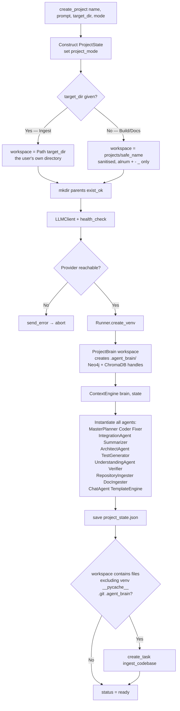

**Two details of consequence:**

- **`create_venv` reuses an existing environment.** It probes `venv/`, `.venv/`, `env/`, `.env/` for a Python binary before creating anything. Critical for Ingest mode, where the user's project already has an environment that must not be clobbered.
- **Auto-ingest is universal.** Any workspace containing files triggers ingestion, whatever the mode. The comment in the source states the reason: *"prevent isolated environment hallucination."* If the model cannot see what already exists, it will invent a parallel implementation.

---

## 6. Mode A — Build From Scratch

> **Purpose.** Produce a complete new codebase from a natural-language description, optionally guided by an uploaded specification document.
> **Primary context problem addressed:** Case 2 — output too large.

### 6.1 User Experience

**Dashboard card:** "Build from Scratch" — *Start fresh from a prompt or uploaded document.*

**Form — "Initialize Workspace":**

| Field | Element | Required | Purpose |
|---|---|---|---|
| Project Name | `#project-name` text | Yes | Sanitised into the folder name under `projects/`. |
| Initial Context | `#project-prompt` textarea | No | The build description — architecture guidance, goals, tech stack. |
| Upload Document | `#project-file` file input | No | A single spec file. **Rendered only in Build mode.** Helper text: *"If provided, the system will immediately build the code based on this document."* |

**Submit** → `POST /api/project/create` as `multipart/form-data` with `name`, `prompt`, `mode="build"`, and optional `file`.

### 6.2 Backend Flow

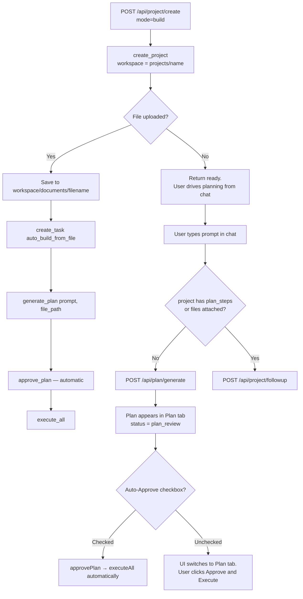

**`auto_build_from_file` — the zero-touch path.** When a document is uploaded at creation time in Build mode, the system runs plan → approve → execute with no human gate. This is the "hand it a spec, come back to a finished project" workflow.

### 6.3 How Build Mode Bounds Output Size

This is the mode where Case 2 is solved. Four mechanisms stack:

#### 6.3.1 Scale classification first

Before any architecture work, `MasterPlanner.generate_epic_queue()` classifies the request:

| Scale | File count | Epics emitted |
|---|---|---|
| `simple` | 1–5 | exactly 1 |
| `medium` | 5–30 | 1–3 |
| `large` | 30–100 | 3–10 |
| `massive` | 100+ | 10+ (bounded domains) |

The output of this call is small regardless of the eventual project size — a list of names, purposes, and API contracts. It also yields `project_entry_point`, the single starting file for the system.

#### 6.3.2 Two planning strategies

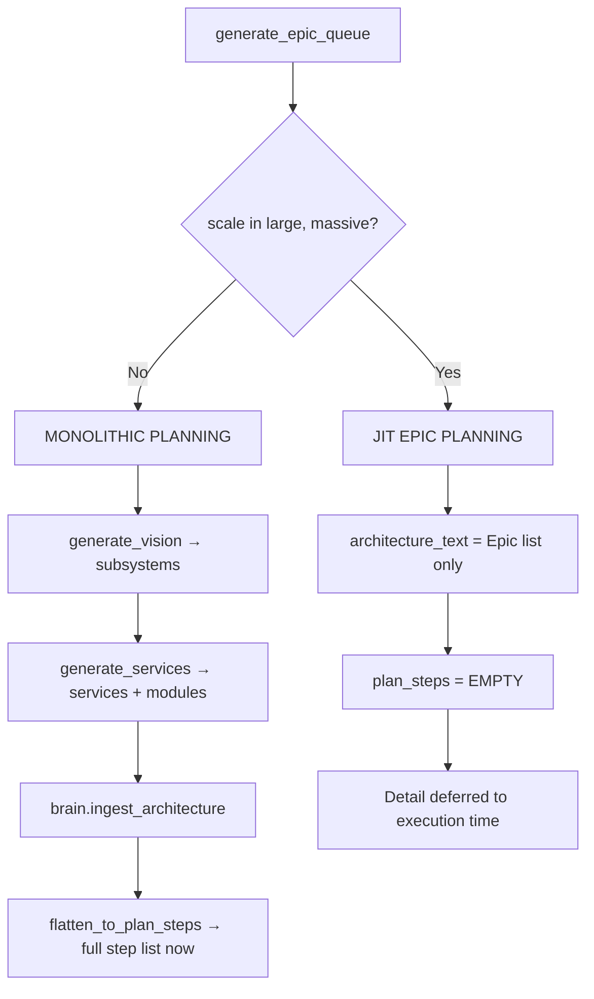

**The JIT path is the key idea.** For a massive project, generating the full file-by-file plan up front would itself exceed the output window. Instead only the Epic skeleton is produced; each Epic's detailed sprint plan is generated at the moment that Epic begins to execute:

```python
# inside execute_all's epic loop
epic = await self.master_planner.generate_sprint_plan(
    epic,
    self.state.get_file_registry_string(),   # what already exists (AST facts)
    self.state.get_completed_summaries(),    # what previous Epics achieved
    self.state.project_entry_point,          # where to wire it in
    on_token=on_sprint_token,
)
new_steps = self.master_planner.flatten_to_plan_steps(
    ArchitectureSpec(name=epic.name, subsystems=[epic.subsystem])
)
for s in new_steps:
    s.step_number += len(self.state.plan_steps)   # offset onto the existing plan
    s.epic_id = epic.id                            # bind for UI grouping
self.state.plan_steps.extend(new_steps)
```

Each sprint-planning call therefore sees only *one* Epic's requirements plus a compressed view of prior work. Planning output per call is bounded; total planning output across the project is unbounded.

The UI models this explicitly — an Epic with no steps yet renders **"Waiting for JIT Planning…"**.

#### 6.3.3 One file per step

`flatten_to_plan_steps` walks Subsystem → Service → Module and emits one `PlanStep` per module, then appends `requirements.txt` (depending on all Python steps) and `README.md` (depending on everything). Generation is therefore always a single-file task.

#### 6.3.4 Contract-first scaffolding (Phase 0)

Before any implementation, for the whole set of uncompleted steps:

1. **Template path.** `TemplateEngine.get_template_for_file()` matches by filename convention:

   | Pattern | Template | Cost |
   |---|---|---|
   | `*_model.py`, `models.py` | `model.py.j2` (Pydantic `BaseModel`) | 0 tokens |
   | `*_service.py`, `service.py` | `service.py.j2` (async CRUD service class) | 0 tokens |
   | `*_controller.py`, `*_api.py`, `*_router.py` | `api_endpoint.py.j2` (FastAPI `APIRouter`) | 0 tokens |

   Matched files are rendered by Jinja2 and written directly — **no LLM call at all**.

2. **Architect path.** Everything else goes to `ArchitectAgent.generate_stubs()`, which emits a single JSON object mapping file paths to signature-only skeletons — imports, class definitions, typed method signatures, `pass` or `raise NotImplementedError`. No logic.

**Why this matters for context.** Once stubs exist, the implementation call for file B does not need file A's body — only its signature, which the AST registry already holds. Contract-first converts an O(n²) cross-file-knowledge problem into an O(n) one.

### 6.4 Execution Pipeline (`execute_all`)

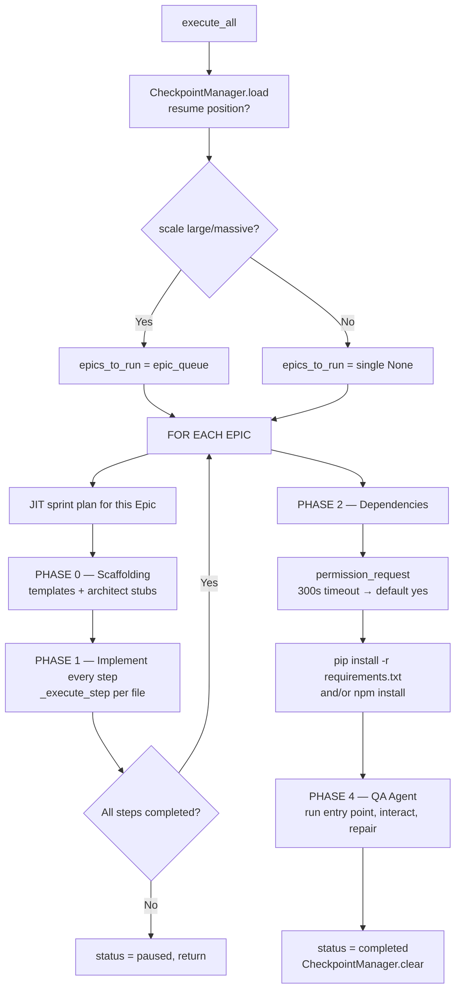

> **Note.** There is no "Phase 3" in the code; the numbering is historical. Phases 2 and 4 sit *outside* the Epic loop and run once at the end.

### 6.5 Per-Step Pipeline (`_execute_step`)

This is the heart of the system. Executed once per file.

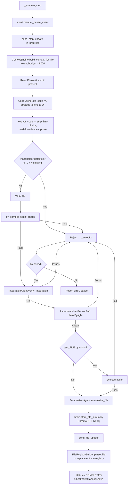

Note the ordering: **cheap deterministic checks before expensive semantic ones.** `py_compile` costs milliseconds and catches the most common failure; the LLM-based integration review only runs on syntactically valid code.

### 6.6 Follow-Up Requests in Build Mode

Once a project exists, chat input goes to `POST /api/project/followup` → `handle_manual_fix`, which first classifies intent with a one-word LLM call:

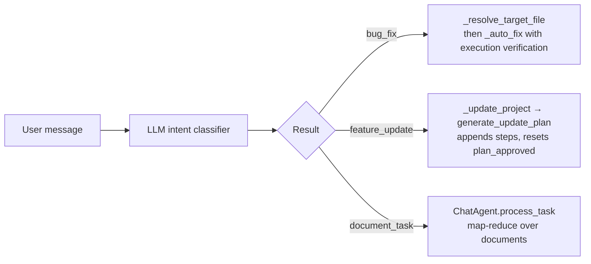

`_resolve_target_file` is notable: it parses `File "..."` frames out of a pasted traceback, resolves each against the workspace root, and takes the **deepest** frame that lies inside the workspace — so pasting a raw stack trace targets the correct file automatically, falling back to a basename search and finally to the entry point.

---

## 7. Mode B — Ingest Existing Codebase

> **Purpose.** Point the agent at an existing local codebase, have it build a complete understanding, then add features or fix bugs *inside that codebase* without breaking it.
> **Primary context problem addressed:** Case 1 — input too large.

### 7.1 User Experience

**Dashboard card:** "Ingest Codebase" — *Import and modify an existing local codebase.*

**Form — "Ingest Codebase":**

| Field | Element | Required | Purpose |
|---|---|---|---|
| Project Name | `#project-name` text | Yes | Display label only — does **not** create a folder. |
| Absolute Directory Path | `#codebase-path` text | Yes | Full path to the existing codebase. Free text; no directory picker. |

**Submit** → `POST /api/project/ingest`, JSON `{name, path}` (note: JSON, not `FormData`, unlike the other two modes).

### 7.2 A Critical Architectural Distinction

```python
# server.py
result = await orchestrator.create_project(
    name=req.name, prompt="", target_dir=req.path, mode="ingest"
)
asyncio.create_task(orchestrator.ingest_codebase())
```

Because `target_dir` is supplied, `create_project` sets:

```python
self.workspace_dir = Path(target_dir).resolve()
```

**The workspace *is* the user's own directory.** Consequences:

- `.agent_brain/` (ChromaDB, ADRs, `architecture_spec.json`, `checkpoint.json`) is created **inside the user's codebase**.
- `project_state.json`, `architecture.md`, and `plan.txt` are written **into the user's codebase root**.
- Generated and edited files land directly in the real project — there is no staging copy.
- `create_venv` reuses the project's existing `venv/`, `.venv/`, `env/`, or `.env/` if one is found.

> ⚠️ **Operational note.** There is no git safety net built in. Ingest mode edits real files in place. Users should be on a clean branch or have a backup before ingesting.

### 7.3 The Ingestion Pipeline

This pipeline is the system's answer to "the input is millions of lines."

```mermaid
flowchart TD
    A[ingest_codebase] --> B[Acquire _ingestion_lock<br/>second caller returns Already ingesting]
    B --> C[STAGE 1 — Structural extraction]
    C --> C1[brain.update_graphify_knowledge]
    C1 --> C2[graphify.extract over all source files<br/>filtered: venv node_modules .git __pycache__<br/>site-packages dist build caches]
    C2 --> C3[Neo4j: Symbol nodes, File nodes,<br/>File-CONTAINS-Symbol,<br/>Symbol-CALLS-Symbol edges]
    C3 --> D[STAGE 2 — Semantic extraction]
    D --> D1[rglob *.py *.js *.jsx *.ts *.tsx *.md]
    D1 --> D2[asyncio.Semaphore 10<br/>bounded concurrency]
    D2 --> D3[PER FILE — never more than one]
    D3 --> D4[truncate_to_tokens content, 4000]
    D4 --> D5[SummarizerAgent → strict JSON:<br/>purpose responsibilities exports<br/>dependencies constraints risks]
    D5 --> D6[ChromaDB upsert<br/>+ Neo4j File.purpose<br/>+ DEPENDS_ON edges]
    D6 --> D7[AST parse .py → FileEntry<br/>into state.file_registry]
    D7 --> E[STAGE 3 — Architecture synthesis]
    E --> E1[UnderstandingAgent.analyze_codebase]
    E1 --> E2[Cypher: File + collect Symbols, LIMIT 200]
    E2 --> E3[Attach stored ChromaDB summaries]
    E3 --> E4[Generate architecture.md<br/>+ extract entry_point tag]
    E4 --> F[state.ingested_architecture_notes = notes<br/>state.project_entry_point = entry point]
    F --> G[save project_state.json]
```

#### Why this bounds the input

| Property | Guarantee |
|---|---|
| Stage 1 uses no LLM at all | AST extraction is deterministic parsing. A 10M-line repo costs zero tokens here. |
| Stage 2 processes exactly one file per LLM call | Each file is additionally capped at 4,000 tokens. **The largest input any call sees is one truncated file** — independent of repository size. |
| Stage 2 is concurrent but bounded | `Semaphore(10)` — throughput without unbounded memory or rate-limit collapse. |
| Stage 3 reads *derived data only* | The architecture synthesis call receives graph query results and stored summaries, never raw source. Capped at 200 files by the Cypher `LIMIT`. |

The aggregate understanding lives in Neo4j and ChromaDB. It is never assembled into a single prompt.

#### The Summarizer's contract

```json
{
  "purpose": "1–2 sentence summary",
  "responsibilities": ["..."],
  "exports": ["ClassName", "function_name"],
  "dependencies": ["src/internal_module.py", "third_party_lib"],
  "constraints": ["Must be thread-safe"],
  "risks": ["Fails if network is down"]
}
```

`dependencies` is what materialises `DEPENDS_ON` edges in Neo4j, which is what later powers 2-hop related-file retrieval. Called with `disable_think=True` — reasoning tokens are pure waste for a structured extraction task run thousands of times.

#### The Understanding Agent's contract

Produces a deep `architecture.md` and, critically, terminates with:

```
<entry_point>backend/server.py</entry_point>
```

Identifying the real entry point is what allows subsequent planning to *edit* the existing startup path rather than creating a competing `main.py`.

### 7.4 How Ingested Knowledge Steers Planning

Two injections, both in `Orchestrator.generate_plan`:

**1. Architecture context prefix**

```python
if getattr(self.state, "ingested_architecture_notes", ""):
    planning_prompt = (
        f"Existing Codebase Architecture Context:\n{notes}\n\n"
        f"USER REQUEST:\n{planning_prompt}"
    )
```

**2. The edit-don't-recreate directive** — mode-specific, and the single most important line in Ingest mode:

```python
if getattr(self.state, "project_mode", "") == "ingest":
    planning_prompt += (
        "\n\nCRITICAL RULE FOR INGESTION MODE: You MUST prioritize editing "
        "existing files (like the root main.py). Do NOT create new files or "
        "new entry points unless absolutely necessary to avoid breaking the "
        "existing architecture. Your goal is to integrate directly into the old code."
    )
```

Reinforced downstream by:

- `MasterPlanner.SERVICES_SYSTEM_PROMPT` — *"INTEGRATION MANDATE: If modifying an existing codebase, you MUST identify existing entry points from the context and output a module modification for them… Do NOT leave new code files disconnected."*
- `MasterPlanner.GLOBAL_ARCHITECTURE_RULES` — *"CONNECT OLD TO NEW: Always modify existing entry points to integrate new code. Do not leave code orphaned."*

### 7.5 Editing Existing Files Safely

When a `PlanStep` targets an existing file, `_execute_step` reads the current content and passes it as `stub_content`, instructing the model to return the complete file. The dedicated repair path is stricter — `Fixer` uses SEARCH/REPLACE blocks with a four-level matching cascade:

| Level | Strategy | Rationale |
|---|---|---|
| 1 | Exact substring match | Fast path. |
| 2 | Whitespace-stripped match | Model reproduced content with different indentation. |
| 3 | Comment-stripped line-window match | Model paraphrased or dropped inline comments. |
| 4 | `difflib.SequenceMatcher` fuzzy window, ratio ≥ 0.75 | Last resort before escalation. |

After `MAX_SEARCH_FAILURES = 15` failures on one file, the system escalates and demands a complete rewrite of that file in a fenced block. Every successful edit is followed by a syntax check; a fix that breaks syntax is fed straight back into the loop.

---

## 8. Mode C — Documents

> **Purpose.** Ingest large requirement documents (PDF / TXT / MD), answer questions over them, and use them as the specification driving code generation.
> **Primary context problem addressed:** Case 1 — unstructured input too large.

### 8.1 User Experience

**Dashboard card:** "Docs Operations" — *Chat with and analyze documents only.*

**Form — "Docs Workspace":** shares the Build form's JSX branch with three differences:

| Aspect | Build | Docs |
|---|---|---|
| Heading | "Initialize Workspace" | "Docs Workspace" |
| Prompt placeholder | *"Provide architecture guidelines, target goals, or specific tech stack details…"* | *"Provide instructions for how you want to analyze or chat with the documents…"* |
| File input on the creation form | **Rendered** | **Not rendered** |

**Submit** → `POST /api/project/create` with `mode="docs"` — the *same endpoint as Build*, differing only in the mode field.

> **Design consequence:** documents in Docs mode are uploaded **after** workspace creation, through the **paperclip attachment in the chat composer**, not through a dedicated upload form. The dedicated endpoints `POST /api/documents/ingest` and `POST /api/documents/consolidate` exist and are wired in `services/api.js`, but no UI element reaches them. All document flow goes through `POST /api/project/followup` with a `files[]` array.

### 8.2 UI Adaptation

`Workspace.jsx` reads `project_mode === 'docs'` and:

- Initialises `activeTab` to `'graph'` instead of `'code'`.
- **Does not render** the Plan and Source Code tabs at all.
- Relabels the remaining tab from "Knowledge" to **"Documents"**.

The result is a document-analysis console rather than an IDE.

### 8.3 The Document Ingestion Pipeline

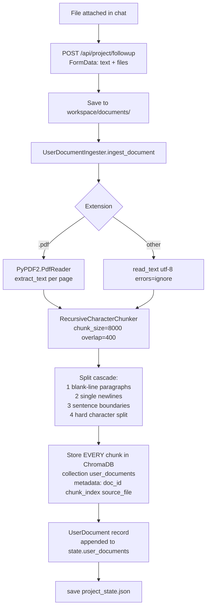

**The chunker's cascade** preserves semantic boundaries in order of preference, so a chunk rarely splits mid-sentence. The 400-character overlap ensures a fact spanning a boundary appears in full in at least one chunk.

### 8.4 Map-Reduce Analysis — `ChatAgent.process_task`

This is the most complete context-handling implementation in the codebase, and the correct model for how oversized input should be processed.

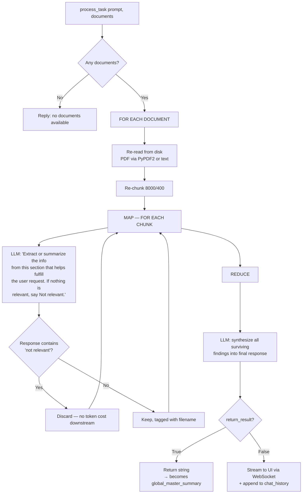

**Why this genuinely solves Case 1:**

| Property | Effect |
|---|---|
| Map stage sees exactly one 8,000-character chunk per call | Input per call is constant regardless of document size. |
| Irrelevant chunks are dropped at map time | Reduce-stage input scales with *relevance*, not document length. |
| Progress is streamed per chunk | `"Analyzing report.pdf (part 3/47)…"` — a 500-page PDF is legible in the UI. |
| Works over multiple documents simultaneously | Findings are filename-tagged so provenance survives into the reduce stage. |

### 8.5 Documents as Specification

Documents do not only answer questions — they drive code generation. In `generate_plan`:

```python
if file_paths:
    for fp in file_paths:
        await self.doc_ingester.ingest_document(fp, Path(fp).name, on_status=...)

    extracted_reqs = await self.chat_agent.process_task(
        "Extract a detailed master specification and architecture plan "
        "from these documents to build the software.",
        self.state.user_documents,
        return_result=True,
    )
    self.state.global_master_summary = extracted_reqs
```

The map-reduce output becomes `global_master_summary`, which is then prepended to the planning prompt:

```python
if getattr(self.state, "global_master_summary", ""):
    planning_prompt = (
        f"GLOBAL MASTER SPECIFICATION (from uploaded documents):\n"
        f"{self.state.global_master_summary}\n\n{planning_prompt}"
    )
```

**A 300-page specification is thereby compressed — losslessly with respect to relevance — into a planning prompt that fits the window.** The same mechanism runs in `_update_project` for document-driven feature additions.

### 8.6 Final Planning Prompt Composition

The layering order in `generate_plan` (later prefixes wrap earlier ones):

```
┌─────────────────────────────────────────────────────┐
│ GLOBAL MASTER SPECIFICATION (from documents)        │  ← Docs mode
│   …map-reduced spec…                                 │
├─────────────────────────────────────────────────────┤
│ Existing Codebase Architecture Context               │  ← Ingest mode
│   …UnderstandingAgent architecture.md…               │
├─────────────────────────────────────────────────────┤
│ USER REQUEST                                         │  ← always
│   …original_prompt…                                  │
├─────────────────────────────────────────────────────┤
│ CRITICAL RULE FOR INGESTION MODE: …                  │  ← Ingest mode
└─────────────────────────────────────────────────────┘
```

All three modes contribute to the same prompt structure. **This is precisely how Case 3 is handled** — see §9.3.

---

## 9. Cross-Mode Comparison and Composition

### 9.1 Comparison Matrix

| Dimension | **Build** | **Ingest** | **Docs** |
|---|---|---|---|
| Dashboard card | Build from Scratch | Ingest Codebase | Docs Operations |
| Endpoint | `POST /api/project/create` | `POST /api/project/ingest` | `POST /api/project/create` |
| Body encoding | `multipart/form-data` | `application/json` | `multipart/form-data` |
| `project_mode` | `"build"` | `"ingest"` | `"docs"` |
| Workspace location | `projects/<sanitised-name>/` | **the user's own directory** | `projects/<sanitised-name>/` |
| `.agent_brain` location | inside new workspace | **inside the user's codebase** | inside new workspace |
| venv behaviour | creates `venv/` | reuses existing if found | creates `venv/` |
| File upload at creation | ✅ single file | ✗ | ✗ (chat only) |
| Auto-build on upload | ✅ `auto_build_from_file` | ✗ | ✗ |
| Repository ingestion | only if folder non-empty | ✅ always | only if folder non-empty |
| Document ingestion | ✅ via chat / creation upload | ✅ via chat | ✅ via chat (primary) |
| Planning prompt prefix | — | architecture notes + edit directive | master specification |
| UI tabs | Plan · Source Code · Knowledge | Plan · Source Code · Knowledge | **Documents only** |
| Initial tab | Code | Code | Graph |
| Context problem | **Case 2 — output** | **Case 1 — input (code)** | **Case 1 — input (prose)** |

### 9.2 Which Subsystems Each Mode Activates

| Subsystem | Build | Ingest | Docs |
|---|---|---|---|
| `MasterPlanner` (Epic / vision / services) | ✅ | ✅ | ⚪ only if code is requested |
| `RepositoryIngester` + `graphify` | ⚪ if folder non-empty | ✅ | ⚪ |
| `UnderstandingAgent` | ⚪ | ✅ | ⚪ |
| `UserDocumentIngester` + chunker | ⚪ if file attached | ⚪ if file attached | ✅ |
| `ChatAgent` map-reduce | ⚪ | ⚪ | ✅ |
| `ArchitectAgent` + `TemplateEngine` | ✅ | ✅ | ⚪ |
| `Coder` / `Fixer` / `IntegrationAgent` | ✅ | ✅ | ⚪ |
| `IncrementalVerifier` (Ruff / Pyright) | ✅ | ✅ | ⚪ |
| `QAAgent` | ✅ | ✅ | ⚪ |
| `ProjectBrain` (Neo4j + ChromaDB) | ✅ | ✅ | ✅ |

Legend: ✅ always · ⚪ conditional

### 9.3 Composition — How the Modes Together Solve Case 3

Case 3 (large input *and* large output) is not a fourth mode. It is the natural composition of the mechanisms above, and it occurs whenever a user ingests a substantial codebase and then requests a substantial feature.

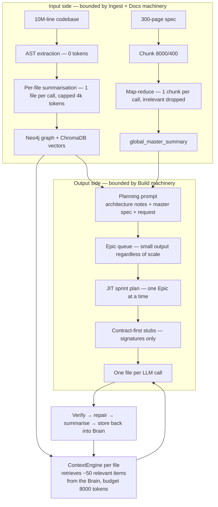

The feedback loop at the bottom is the essential part: every file written is immediately summarised back into the Brain, so file 78 can retrieve file 2's real signature — **without file 2 and file 78 ever appearing in the same context window.** This is the sentence that opens `core/brain/knowledge_graph.py`:

> *"This is the primary mechanism for 'file 78 knowing about file 2' without both ever appearing in the same LLM context window."*

---
---

# PART III — SUBSYSTEM REFERENCE

---

## 10. The Project Brain

`core/brain/project_brain.py` — the façade coordinating all persistent memory.

### 10.1 Structure

```
<workspace>/.agent_brain/
├── chroma/                     ChromaDB persistent store
│   └── chroma.sqlite3
├── adrs/                       Architecture Decision Records (one JSON per ADR)
├── architecture_spec.json      Serialised ArchitectureSpec (merged on re-ingest)
└── checkpoint.json             {current_epic_id, current_step_number, status}
```

### 10.2 The Three Memory Systems

| Store | Technology | Holds | Answers |
|---|---|---|---|
| **Knowledge Graph** | Neo4j (bolt) | Relationships | *"What connects to what?"* |
| **Semantic Store** | ChromaDB (embedded, cosine) | Meaning | *"What is similar to this?"* |
| **File Registry** | Python `ast`, in `ProjectState` | Exact structure | *"What is the precise signature?"* |

Each answers a question the others cannot. The graph knows `auth.py` imports `db.py` but not that both concern "user identity." The vector store knows they are semantically related but not the exact call signature. The AST registry knows `authenticate(credentials: Credentials) -> Session` exactly but nothing about relationships.

### 10.3 Knowledge Graph Schema

**Nodes:** `Project`, `Subsystem`, `Service`, `Module`, `File`, `Symbol`, `Class`, `Function`
**Edges:** `OWNS` (hierarchy), `DEPENDS_ON` (import-level), `CONTAINS` (file → symbol), `CALLS` (symbol → symbol), `USES`, `IMPLEMENTS`, `IMPORTS`

```
(Project)-[:OWNS]->(Subsystem)-[:OWNS]->(Service)-[:OWNS]->(File)
(File)-[:DEPENDS_ON]->(File)
(File)-[:CONTAINS]->(Symbol)-[:CALLS]->(Symbol)
```

Indexes are created on `Project.name`, `Subsystem.name`, `Service.name`, `Module.name`, `File.path`, `Class.name`, `Function.name`.

**Key queries:**

| Method | Cypher shape | Use |
|---|---|---|
| `get_related_files(path, depth=2)` | `(f:File {path})-[r*1..2]-(related:File)` | Core context retrieval. |
| `get_subsystem_for_file(path)` | `(sub:Subsystem)-[:OWNS*]->(f:File {path})` | Architectural placement. |
| `get_dependency_chain(path)` | `(f:File {path})-[:DEPENDS_ON*]->(dep:File)` | Build ordering. |
| `get_impact_analysis(path)` | reverse `DEPENDS_ON\|IMPORTS*` | What breaks if this changes. |
| `get_architecture_overview()` | subsystems + services + file counts | Prompt header. |
| `get_graph_data(project_name)` | all nodes + edges | 3D visualisation. |

`clear_project` uses a *directed* traversal (`-[:OWNS|CONTAINS*0..]->`) rather than an undirected one — a deliberate guard against path explosion and OOM on large graphs.

### 10.4 Semantic Store Collections

| Collection | Contents | Document ID |
|---|---|---|
| `file_summaries` | Per-file semantic summaries | path with `/`, `\`, `.` → `_` (upsert semantics) |
| `architecture_specs` | Subsystem and service descriptions | entity UUID |
| `adrs` | Architecture Decision Records | ADR id |
| `user_documents` | Raw chunks of uploaded documents | `{doc_id}_chunk_{index}` |
| `change_history` | Declared; not currently written | — |

All collections use `{"hnsw:space": "cosine"}`. Every write is an `upsert`, so re-ingesting a file replaces rather than duplicates its entry.

### 10.5 Architecture Decision Records

ADRs capture *why* a design choice was made — context, decision, alternatives, consequences, risks — so that a generation call weeks later can honour a decision it never witnessed. Stored to disk as JSON and indexed in ChromaDB for semantic retrieval. `ContextEngine` injects the top 3 relevant ADRs into each file's context.

### 10.6 Degradation

```python
log.info("ProjectBrain initialized: graph=%s, semantic=%s",
         "connected" if self.graph.is_available else "offline",
         "connected" if self.semantic.is_available else "offline")
```

Every graph method early-returns `[]` / `None` when `self._driver is None`; every semantic method early-returns when the client is `None`. With both offline, `ContextEngine` falls back to the full AST registry string. The system still builds — with less precision.

---

## 11. The Planning Engine

`core/planners/master_planner.py`

### 11.1 Global Architecture Rules

Injected into the vision and complexity prompts:

1. **Full-stack developer** — if a request implies a UI, generate both frontend and backend subsystems.
2. **Single starting point** — exactly one entry point per environment (one backend, one frontend); never one per Epic.
3. **Connect old to new** — always modify existing entry points; never leave code orphaned.

### 11.2 Pipeline Stages

| Stage | Method | Input | Output | Output size |
|---|---|---|---|---|
| Complexity | `generate_epic_queue` | user prompt | scale + entry point + Epic list | Small — always |
| Vision | `generate_vision` | user prompt | `ArchitectureSpec` with subsystems | Small |
| Services | `generate_services` | `ArchitectureSpec` + prompt | subsystems → services → modules | Medium |
| JIT Sprint | `generate_sprint_plan` | one Epic + registry + summaries | that Epic's services and modules | Medium, **per Epic** |
| Flatten | `flatten_to_plan_steps` | `ArchitectureSpec` | ordered `PlanStep` list | — (deterministic) |
| Update | `generate_update_plan` | prompt + state | JSON array of MODIFY/NEW steps | Small |

### 11.3 Robust JSON Parsing

Every parser applies the same defensive cascade — necessary because small local models leak reasoning and markdown despite explicit instructions:

```python
cleaned = re.sub(r'<think>.*?</think>', '', raw, flags=re.DOTALL)
cleaned = re.sub(r'Thinking\.\.\..*?\.\.\.done thinking\.', '', cleaned, flags=re.DOTALL)
if m := re.search(r'```(?:json)?\s*\n?(.*?)\n?```', cleaned, re.DOTALL):
    cleaned = m.group(1)
start, end = cleaned.find('{'), cleaned.rfind('}')
if start >= 0 and end > start:
    cleaned = cleaned[start:end + 1]
```

Every parser also has a **structured fallback**: a failed vision parse yields a single "Core" subsystem; a failed services parse synthesises one default service per subsystem; a failed Epic parse yields one "Core System" Epic. Planning never hard-fails on a malformed response.

### 11.4 Flattening Rules

- One `PlanStep` per module.
- `README.md` and `requirements.txt` encountered mid-hierarchy are skipped and re-appended at the end.
- `requirements.txt` depends on all `.py` steps; `README.md` depends on everything.
- Module `dependencies` are resolved to step numbers where the referenced path is already a step.
- Descriptions are enriched with service interfaces and expected exports.

---

## 12. The Context Retrieval Engine

`core/retrieval/context_engine.py` — the component that makes per-call context independent of project size.

### 12.1 Assembly Algorithm

Given `(file_path, task_description, token_budget = 8000)`:

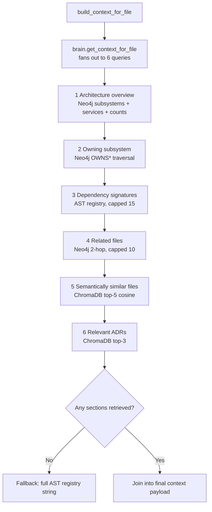

Every section is measured with `LLMClient.count_tokens` and **admitted only if it fits the remaining budget**. Sections are ordered by importance, so under pressure the least important are dropped first — the payload degrades gracefully rather than truncating mid-structure.

### 12.2 Why Six Sources

| Source | Question answered | Failure it prevents |
|---|---|---|
| Architecture overview | Where does this fit? | Building in the wrong layer. |
| Owning subsystem | What are my boundaries? | Scope creep across subsystems. |
| Dependency signatures (AST) | What is the exact API? | **Code stitching** — the primary failure mode. |
| Related files (2-hop graph) | What else is affected? | Breaking downstream consumers. |
| Similar files (vectors) | How is this done elsewhere? | Inconsistent patterns; reinventing utilities. |
| ADRs | What was already decided? | Contradicting earlier design decisions. |

### 12.3 Change Impact Analysis

`build_impact_context(file_path)` produces a human-readable report of affected files, services, and subsystems before a modification — surfacing blast radius from the graph rather than from guesswork.

---

## 13. Code Generation Pipeline

### 13.1 `Coder.generate_code_v2` — the live path

```python
system_prompt = ("You are an elite Software Engineer. You must output the entire "
                 "file content. Never use placeholders like '# ...' or '// ...'.")

prompt = f"TASK:\n{step.description}\n\nFILE PATH:\n{step.file_path}\n\nCONTEXT:\n{context_text}\n\n"
if stub_content:
    prompt += f"EXISTING SKELETON:\n{stub_content}\n\n"
    prompt += "Implement the actual logic inside the provided skeleton. You MUST return the complete file."
else:
    prompt += "Write the complete, runnable code for the requested file now."
```

Deliberately minimal. The heavy lifting is in `context_text`, assembled by the `ContextEngine`.

### 13.2 Output Extraction — `_extract_code`

Local models wrap code in markdown, prose, reasoning tags, and occasionally triple-quoted strings. The extractor applies, in order:

1. Strip `<think>…</think>` — **including unclosed blocks** (the model hit its token limit mid-reasoning).
2. Strip Ollama's `Thinking… …done thinking.` CLI format.
3. Markdown/text files: extract from a `markdown`/`md`/`text` fence if present, else return raw.
4. Language-hinted fence matching by file extension (`.py`→`python`, `.jsx`→`jsx`, …), tolerating unclosed fences at EOF.
5. Generic fence matching — **takes the last block** (the model often explains first, then emits the real file).
6. Triple-single-quote variants (`'''python`).
7. Conversational prefix/suffix stripping ("Here is…", "Let me know…").

### 13.3 Placeholder Rejection

```python
if "# ..." in code or "# existing" in code.lower() or "# ... existing" in code.lower():
    return False, "LLM returned a placeholder snippet. You MUST output the ENTIRE file…"
```

A hard gate. Placeholder elision is the most damaging silent failure in multi-file generation — the file looks plausible and is structurally destroyed.

### 13.4 Legacy XML Tool-Loop (`generate_code`)

Not used by the web orchestrator, but retained and used by `cli.py`. Implements an agentic loop over four XML tools — `<write_file>`, `<edit_file>` (SEARCH/REPLACE), `<run_command>`, `<done>` — for up to 5 iterations, feeding tool results back as `SYSTEM:` turns. Every path is security-checked with `is_within_workspace`.

---

## 14. Verification and Self-Healing

### 14.1 The Verification Ladder

| # | Check | Tool | Cost | Catches |
|---|---|---|---|---|
| 1 | Placeholder scan | string match | ~0 | Elided code |
| 2 | Syntax | `python -m py_compile` | ms | Malformed code |
| 3 | Integration | LLM (`IntegrationAgent`) | 1 call | Signature/API mismatches |
| 4 | Lint | Ruff | ms | Unused imports, style, empty f-strings |
| 5 | Types | Pyright | seconds | Type and signature errors |
| 6 | Unit tests | pytest | seconds | Behavioural regressions |
| 7 | End-to-end | `QAAgent` | minutes | Runtime failures, integration breaks |

Ordered cheapest-first. Ruff and Pyright are resolved from the project venv when present and **skipped gracefully** on `FileNotFoundError` rather than failing the build.

### 14.2 The Fixer — Autonomous Repair Agent

`core/fixer.py` runs a tool-using agentic loop (up to 30 iterations per invocation):

| Tool | Purpose |
|---|---|
| `<view_file>path</view_file>` | Read any workspace file — the model can *investigate* rather than guess. |
| `<edit_file path="…">` + SEARCH/REPLACE | Localised patch. |
| `<run_command>…</run_command>` | Execute a command in the sandbox and observe output. |
| `<done>` | Signal completion; hand back for verification. |

**Special-case fast path.** `ModuleNotFoundError` is intercepted before any LLM call and resolved by `pip install`, with a name-mapping table for the common mismatches:

```
cv2 → opencv-python · bs4 → beautifulsoup4 · PIL → Pillow · yaml → PyYAML
dotenv → python-dotenv · sklearn → scikit-learn · jwt → PyJWT · serial → pyserial
usb → pyusb · gi → PyGObject
```

Missing *internal* modules (`src.*`) are explicitly not auto-installed — that indicates a missing generated file, not a missing package.

**Fix history as memory.** Every attempt is appended to `state.fix_history` and the last five are injected into subsequent fixer prompts under *"PREVIOUS FIXES ATTEMPTED IN THIS PROJECT (Do not repeat failed approaches)."* This is what breaks repair loops that would otherwise oscillate between two wrong fixes.

### 14.3 The Orchestrator's `_auto_fix` Wrapper

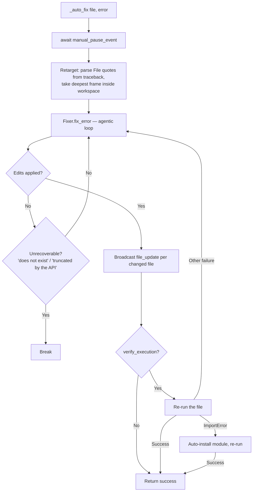

Bounded by `MAX_FIX_ATTEMPTS`, currently **999999** — effectively unlimited, deliberately, so unattended builds are not abandoned. The `_manual_pause_event` await at the top of each iteration means the user can interrupt a runaway loop at any time.

---

## 15. The QA Agent

`core/qa_agent.py` — the final gate. Runs the finished application and interacts with it as a human tester would. It never modifies source; it produces bug reports which feed the Fixer.

### 15.1 Mechanism

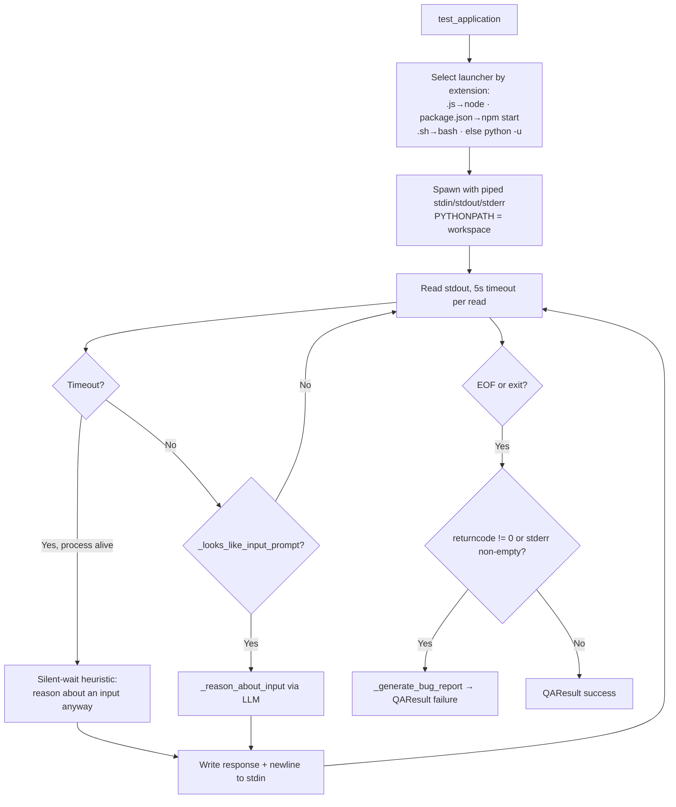

### 15.2 Prompt Detection Heuristic

A chunk is treated as an input prompt when it **both** ends with `:`, `?`, `> `, `>>> `, or `$ ` **and** contains one of: `enter`, `input`, `type`, `choose`, `select`, `name`, `password`, `username`, `option`, `choice`, `press`, `provide`, `specify`. Requiring both conditions suppresses false positives on ordinary output ending in a colon.

### 15.3 Input Reasoning

The LLM is instructed to act as a human user, with three explicit guards:

1. Never echo the program's own output back at it.
2. If the application is itself an AI agent or chatbot, behave like a developer talking to it (*"write a python function to sort a list"*).
3. If the program is looping on the same prompt, send `exit` / `quit`.

Bounded by `MAX_QA_INTERACTIONS = 20` and `QA_PROCESS_TIMEOUT = 1000 s`.

### 15.4 The Test–Repair Cycle

`Orchestrator._run_qa_test_loop` runs up to `MAX_QA_ATTEMPTS = 10` cycles of: run → on failure produce bug report → `_auto_fix` → re-run. This is the only stage that validates the system *as a whole* rather than file by file.

---

## 16. The LLM Client

`core/llm_client.py` — the single abstraction over three providers.

### 16.1 Providers

| Provider | Endpoint | Selection |
|---|---|---|
| **Ollama** (default) | `POST {base}/api/chat`, `stream: true`, `think: true` | when neither flag is set |
| **Groq** | `POST https://api.groq.com/openai/v1/chat/completions` | `USE_GROQ = True` + `GROQ_API_KEY` |
| **Gemini** | `google-generativeai` SDK, `gemini-2.0-flash` | `USE_GEMINI = True` + `GEMINI_API_KEY` |

Groq's model is switchable at runtime via `POST /api/settings/model`, which mutates `config.GROQ_MODEL` and re-instantiates the client on the orchestrator and its agents.

### 16.2 Reasoning-Token Handling

Reasoning models emit thinking either as a separate field or inline as `<think>…</think>`. Both are handled and routed to the `on_thinking` callback (rendered in the UI's collapsible "Thinking Process" panel) rather than into the content stream:

- **Ollama:** `message.thinking` field, plus a character-level `<think>` / `</think>` tag interceptor that buffers partial tags across chunk boundaries.
- **Groq / OpenAI-compatible:** `delta.reasoning`, `delta.reasoning_content`, `delta.thought`.
- If the provider returns HTTP 400 containing *"does not support thinking"*, the model is added to a class-level `_thinking_unsupported_models` set and the request is retried without it — a self-configuring capability probe.

### 16.3 Failure Handling

| Condition | Response |
|---|---|
| Connection / read / write / pool timeout | Exponential backoff `2.0 × 2ⁿ`, up to `OLLAMA_MAX_RETRIES = 10`. `ConnectError` on Ollama yields an actionable message ("run `ollama serve`"). |
| **HTTP 413 Payload Too Large** | Progressive degradation: halve `max_tokens` (8192 → 4096 → 2048) → drop `max_tokens` entirely → **halve the prompt itself** and retry. |
| HTTP 429 | Honour `Retry-After`; otherwise wait ≥ 20 s; up to 10 attempts. |
| HTTP 5xx | Standard backoff. |
| HTTP 404 (Ollama) | Actionable message naming the missing model and the `ollama pull` command. |
| `finish_reason == "length"` | Logged as truncation; partial output is used rather than discarded. |

The 413 ladder is a direct, low-level expression of the system's thesis: when input does not fit, shrink it systematically rather than failing.

### 16.4 Token Counting

```python
return int(len(text.split()) * 1.3)
```

A word-count heuristic — approximate, but provider-agnostic and dependency-free (no `tiktoken`, which would be wrong for non-OpenAI tokenisers anyway). All budgeting is therefore approximate; the reserved `MIN_GENERATION_BUDGET` provides the margin.

---

## 17. Communication Layer

### 17.1 REST

24 endpoints across seven groups: settings/health, project lifecycle, planning, execution control, process I/O, files, documents. Full inventory in [Appendix A](#appendix-a--rest-api-inventory).

Long-running operations return immediately after scheduling:

```python
@app.post("/api/execute/all")
async def execute_all():
    asyncio.create_task(orchestrator.execute_all())
    return {"status": "execution_started"}
```

### 17.2 WebSocket

Single endpoint `/ws`, managed by `ConnectionManager` (a `Set[WebSocket]` guarded by an `asyncio.Lock`, with dead-socket reaping on broadcast). Envelope:

```json
{ "type": "<message_type>", "data": { ... } }
```

**16 backend-emitted types, 4 client-emitted types.** Full inventory in [Appendix B](#appendix-b--websocket-message-inventory).

---

## 18. Frontend

React 19 · Vite · Tailwind CSS · `react-force-graph-3d` · `lucide-react`.

### 18.1 Structure

| File | Role |
|---|---|
| `frontend/src/main.jsx` | React root, `StrictMode` |
| `frontend/src/App.jsx` | Two-state page switch (dashboard ↔ workspace) — **no router** |
| `frontend/src/pages/Dashboard.jsx` | Project list + the three mode cards and forms |
| `frontend/src/pages/Workspace.jsx` | The full IDE shell (~843 lines) |
| `frontend/src/services/api.js` | All REST calls |
| `frontend/src/hooks/useWebSocket.js` | Socket lifecycle + message dispatch |
| `frontend/src/components/CodeViewer.jsx` | File content pane |
| `frontend/src/components/ArchitectureGraph.jsx` | 3D knowledge graph |

### 18.2 Workspace Layout

```
┌──────────────────────────────────────────────────────────────────────┐
│ ← │ Context Agent — <project>       [ ] Auto-Approve Plan  ● status   │
├──────────┬──────────────────────────────────────┬────────────────────┤
│ EXPLORER │ [Plan] [Source Code] [Knowledge]      │  AI ASSISTANT      │
│          │ ── overall progress bar ──            │                    │
│ file 1   │                                       │  ▸ Thinking Process│
│ file 2   │   ┌─ all three panels mounted ─┐      │  assistant output  │
│ file 3   │   │  toggled by opacity/z-index │      │                    │
│   …      │   └────────────────────────────┘      │  ┌──────────────┐  │
│          │                                       │  │ 📎 composer  │  │
│          ├───────────────────────────────────────┤  └──────────────┘  │
│          │ ▸ Terminal Output                     │                    │
└──────────┴───────────────────────────────────────┴────────────────────┘
```

Tab panels are never unmounted — they are layered and toggled via opacity/z-index, preserving the WebGL context and scroll positions.

### 18.3 Notable Patterns

**Handler-ref indirection.** `useWebSocket` receives a fresh handler object on every render but never re-opens the socket: handlers are mirrored into a ref in a separate effect, and `connect` has an empty dependency array. `connectRef` breaks the closure cycle for reconnection (fixed 2 s, no backoff).

**Server-authoritative reconciliation.** During streaming the UI keeps optimistic local text. On `llm_done` it discards that, calls `GET /api/project/state`, and replaces the message list with the server's canonical `chat_history`.

**Append-coalescing.** `process_stdout` / `process_stderr` mutate the trailing array entry rather than pushing, keeping DOM node count proportional to stream *switches* rather than *chunks*.

**Conditional autoscroll.** A 150 px "near bottom" dead-zone lets the user scroll back through history mid-stream without being yanked to the bottom.

**Agent-action formatting.** Raw XML tool tags are rewritten for humans before display:

```
<view_file>x</view_file>              →  👁️ Viewing: x
<edit_file path="y">…</edit_file>     →  📝 Editing: y      (body swallowed)
<run_command>z</run_command>          →  💻 Running Command: z
```

**Epic progress donuts.** Each Epic renders an SVG ring computed from its steps, with an inline percentage; an Epic with no steps shows "Waiting for JIT Planning…".

### 18.4 Knowledge Graph Visualisation

`ArchitectureGraph.jsx` fetches `/api/graph` once at mount and renders with `react-force-graph-3d`:

| Node label | Colour | Size |
|---|---|---|
| `Subsystem` | blue `#60a5fa` | large (r=10) |
| `Service` | purple `#c084fc` | medium (r=7) |
| `Module` | green `#4ade80` | small (r=4) |
| other | grey `#9ca3af` | small |

THREE.js geometries and materials are module-level singletons so each node allocates only a `Mesh` wrapper. Features: search filter, taxonomy toggles, a Node Inspector showing degree and clickable neighbours, camera fly-to on click (2 s tween), recenter, and zoom.

---

## 19. Security and Sandboxing

### 19.1 Threat Model

The LLM is treated as an **untrusted code generator**. It may produce destructive commands or path traversal — through misunderstanding, hallucination, or prompt injection via an ingested document.

### 19.2 Controls

**Command blocklist** (`config.BLOCKED_COMMANDS` + regex patterns in `SecurityChecker.check_command`) — prefix match *and* word-boundary regex for: `rm`, `rmdir`, `del`, `rd`, `remove`, `unlink`, `shutil.rmtree`, `os.remove`, `os.unlink`, `os.rmdir`, `format`, `mkfs`, `sudo`, `chmod`, `chown`, `shutdown`, `reboot`, `> /dev/…`.

**Dangerous-code scanning** (`config.DANGEROUS_CODE_PATTERNS`) — files are scanned before execution for `os.remove`, `os.unlink`, `os.rmdir`, `shutil.rmtree`, `subprocess…rm`, and writes outside the project tree.

**Workspace confinement** — `SecurityChecker.is_within_workspace` resolves both paths and calls `relative_to`. Enforced before every `<write_file>`, `<edit_file>`, and `<view_file>` operation in both `Coder` and `Fixer`.

**Package-name validation** — `^[a-zA-Z0-9._\-\[\]>=<,!]+$` before any `pip install`, and only `install` is ever permitted (never `uninstall`).

**Environment isolation** — per-project venv; `PYTHONPATH` set to the workspace; `cwd` set to the workspace; venv `bin`/`Scripts` prepended to `PATH` for shell commands.

**Timeouts** — `PROCESS_RUN_TIMEOUT = 1000 s`, `QA_PROCESS_TIMEOUT = 1000 s`, `SYNTAX_CHECK_TIMEOUT = 600 s`, shell commands 15 s, installs 300 s, venv creation 60 s.

**Permission gate** — dependency installation broadcasts a `permission_request` and awaits user response (300 s, then defaults to allow).

### 19.3 Residual Risks

| Risk | Status |
|---|---|
| `run_shell_command` uses `create_subprocess_shell` (shell interpretation) | Mitigated by the blocklist, not eliminated. Chained/obfuscated commands are conceivable. |
| Ingest mode edits the user's real files in place | No automatic git safety net. |
| `CORS_ORIGINS` includes `"*"` | Acceptable for localhost single-user; must change before any network exposure. |
| The permission gate defaults to **allow** on timeout | Deliberate for unattended runs; is a fail-open default. |
| Prompt injection via ingested documents | Not specifically defended. Sandbox controls are the backstop. |

---

## 20. Persistence, Checkpointing and Resumability

### 20.1 `project_state.json`

The complete `ProjectState`, written after essentially every mutation — project creation, plan generation, approval, each step transition, each fix, each chat message. Contains identity, mode, scale, entry point, Epic queue, plan steps, file registry, user documents, master summary, completed-step set, status, step summaries, fix history, chat history, metrics, timestamps, and paths.

### 20.2 `checkpoint.json`

A minimal `{current_epic_id, current_step_number, status}` written after every completed file into `<workspace>/.agent_brain/`. On `execute_all`, a checkpoint causes the Epic loop to skip forward to the recorded Epic. Cleared on successful completion.

### 20.3 Resume Paths

| Scenario | Recovery |
|---|---|
| Backend restarted mid-build | `POST /api/project/load` → full agent re-instantiation; `status: executing` is rewritten to `paused`. |
| User pauses | `_manual_pause_event.clear()`; all loops block at their next boundary. |
| User resumes after a restart | `resume_execution` detects `_executing == False` and relaunches `execute_all`, which resumes from the checkpoint. |
| Step failed | `retry_execution(step_number)` resets that step **and all later steps** to `PENDING` and restarts. |
| Step is unrecoverable | `skip_execution` proceeds to the next phase. |

### 20.4 Durable Artefacts

| Artefact | Location | Written by |
|---|---|---|
| `project_state.json` | workspace root | `ProjectState.save` |
| `architecture.md` | workspace root | `generate_plan` |
| `plan.txt` | workspace root | `generate_plan` |
| `.agent_brain/architecture_spec.json` | brain dir | `ProjectBrain.ingest_architecture` (merged, not overwritten) |
| `.agent_brain/adrs/*.json` | brain dir | `ProjectBrain.store_adr` |
| `.agent_brain/chroma/` | brain dir | ChromaDB |
| `.agent_brain/checkpoint.json` | brain dir | `CheckpointManager` |
| `documents/*` | workspace | upload handlers |
| Neo4j graph | external DB | `KnowledgeGraph` |

---
---

# PART IV — REFERENCE AND ASSESSMENT

---

## 21. Configuration Reference

All in `config.py`.

### LLM

| Setting | Default | Notes |
|---|---|---|
| `USE_GROQ` | `False` | |
| `GROQ_MODEL` | `llama-3.3-70b-versatile` | 12 models pre-listed in `GROQ_MODELS` |
| `USE_GEMINI` | `False` | |
| `OLLAMA_BASE_URL` | `http://127.0.0.1:11434` | |
| `OLLAMA_MODEL` | `llama3.1:8b` | README recommends `qwen3.6:27b` for best results |
| `OLLAMA_NUM_CTX` | `16384` | **The constraint the architecture exists to defeat** |
| `OLLAMA_TEMPERATURE` | `0.3` | Low — determinism over creativity |
| `OLLAMA_REQUEST_TIMEOUT` | `1000` s | |
| `OLLAMA_MAX_RETRIES` | `10` | |
| `OLLAMA_RETRY_BACKOFF` | `2.0` | Exponential base |

### Token budgets

| Setting | Default | Used? |
|---|---|---|
| `TOKEN_BUDGET_SYSTEM_PROMPT` | `5000` | ✅ `SmartChunker` |
| `MIN_GENERATION_BUDGET` | `10000` | ✅ `SmartChunker`, `ContextAssembler` |
| `TOKEN_BUDGET_FILE_REGISTRY` | `20000` | ❌ **never read** |
| `TOKEN_BUDGET_STEP_DESC` | `5000` | ❌ **never read** |
| `TOKEN_BUDGET_SUMMARIES` | `10000` | ❌ **never read** |

### Agent behaviour

| Setting | Default | Used? |
|---|---|---|
| `MAX_FIX_ATTEMPTS` | `999999` | ✅ Effectively unlimited |
| `MAX_QA_ATTEMPTS` | `10` | ✅ |
| `MAX_QA_INTERACTIONS` | `20` | ✅ |
| `QA_PROCESS_TIMEOUT` | `1000` s | ✅ |
| `PROCESS_RUN_TIMEOUT` | `1000` s | ✅ |
| `SYNTAX_CHECK_TIMEOUT` | `600` s | ✅ |
| `MAX_SEMANTIC_FIX_ATTEMPTS` | `30` | ❌ **never read** |
| `MAX_PLAN_RETRIES` | `5` | ❌ **never read** |

### Infrastructure

| Setting | Default |
|---|---|
| `BACKEND_HOST` / `BACKEND_PORT` | `127.0.0.1` / `8088` |
| `CORS_ORIGINS` | localhost variants **plus `"*"`** |
| `NEO4J_URI` | `neo4j://127.0.0.1:7687` (env-overridable) |
| `NEO4J_USER` / `NEO4J_PASSWORD` / `NEO4J_DATABASE` | `neo4j` / `password` / `neo4j` |
| `PROJECTS_DIR` | `<repo>/projects` (created at import) |
| `BRAIN_DIR_NAME` | `.agent_brain` (shadowed by a class constant in `ProjectBrain`) |
| `CUSTOM_RULES_FILE` | `<repo>/.contextrules` — ❌ **never read** (see §24.2) |
| `IS_WINDOWS` / `PYTHON_CMD` / `PIP_CMD` | platform-derived |
| `UI_THEME`, `VENV_ACTIVATE` | ❌ **never read** |

---

## 22. Data Model Reference

### `models/state.py`

| Type | Purpose | Key fields |
|---|---|---|
| `ProjectState` | Single source of truth | `project_mode`, `project_scale`, `project_entry_point`, `epic_queue`, `plan_steps`, `file_registry`, `user_documents`, `global_master_summary`, `completed_steps`, `fix_history`, `chat_history`, `ingested_architecture_notes` |
| `PlanStep` | One file to produce | `step_number`, `title`, `file_path`, `description`, `depends_on`, `status`, `epic_id`, `summary` |
| `FileEntry` | AST-extracted structure | `classes`, `functions`, `imports`, `class_methods`, `function_signatures`, `constants`, `calls` |
| `UserDocument` | Ingested document | `id`, `file_path`, `filename`, `master_summary`, `chunk_count` |
| `StepStatus` | Enum | `pending`, `in_progress`, `completed`, `failed`, `skipped` |

`FileEntry.to_registry_string()` is the exact text the LLM sees for a dependency — concrete names and signatures, never prose. Standard-library imports are filtered out and external imports capped at five to conserve tokens.

### `models/hierarchy.py`

`ArchitectureSpec` → `SubsystemSpec` → `ServiceSpec` → `ModuleSpec`, plus `EpicSpec` (JIT unit), `ArchitectureDecisionRecord`, `SemanticSummary`, `ProjectScale`, `NodeStatus`. All dataclasses with `to_dict` / `from_dict` for JSON round-tripping.

---

## 23. Technology Stack

### Backend

| Package | Role |
|---|---|
| `fastapi` | REST + WebSocket |
| `uvicorn[standard]` | ASGI server |
| `pydantic` | Request validation |
| `httpx` | Async HTTP to Ollama / Groq |
| `websockets` | WS protocol |
| `google-generativeai` | Gemini provider |
| `neo4j` | Knowledge graph driver |
| `chromadb` | Embedded vector store |
| `jinja2` | Code templates |
| `PyPDF2` | PDF text extraction |
| `python-multipart` | File uploads |
| `pytest` | Test execution inside generated projects |
| `networkx` | Declared; dependency analysis |
| `rich` | Terminal UI |

### Frontend

`react@19` · `vite@8` · `tailwindcss@3` · `react-force-graph-3d` · `three` · `lucide-react` · `eslint@10`
Declared but unused: `react-router-dom`, `@xterm/xterm`, `@xterm/addon-fit`, `react-force-graph-2d`.

### External

Ollama · Neo4j Desktop · Ruff · Pyright · Node ≥ 18 · Python ≥ 3.10

---

## 24. Findings — Gaps, Defects and Dead Code

The following were identified by line-level audit. They are recorded here so the document reflects the system as built, not only as designed.

### 24.1 Context-Handling Gaps

**F1 — `SmartChunker` truncates instead of map-reducing.** *(High)*
In `generate_plan`, an oversized *typed* prompt is chunked and then only `chunks[0]` is kept:

```python
if SmartChunker.needs_chunking(planning_prompt):
    chunks = SmartChunker.chunk(planning_prompt)
    planning_prompt = chunks[0] + "\n\n[Prompt truncated for planning...]"
```

A large specification **pasted into the chat box** is silently truncated; the same specification **uploaded as a file** is correctly map-reduced by `ChatAgent`. Two different code paths with very different fidelity for the same user intent.
**Recommendation:** route oversized typed prompts through `ChatAgent.process_task` as a synthetic single document.

**F2 — Document RAG is not reachable during code generation.** *(Medium)*
`ContextAssembler.build_coder_prompt` contains a document-RAG section (`query_document_chunks`, top-3). But the live path is `Coder.generate_code_v2`, which builds its own prompt from `ContextEngine.build_context_for_file` — and `ContextEngine` never queries the document collection. Document chunks therefore influence *planning* but never *per-file generation*; only the compressed `global_master_summary` survives into the build.
**Recommendation:** add a document-chunk retrieval section to `ContextEngine.build_context_for_file`.

**F3 — `UserDocument.master_summary` is never populated.** *(Medium)*
`ingest_document` sets `master_summary=""` and nothing later fills it. Consequently `consolidate_all_documents()` concatenates empty strings, and the `elif` fallback in `generate_plan` that joins per-document summaries produces nothing. Only the `global_master_summary` path works.

### 24.2 Documentation-vs-Implementation Divergence

**F4 — `.contextrules` is never loaded.** *(High — affects documentation accuracy)*
`config.CUSTOM_RULES_FILE` points at `.contextrules`, and both the README and the v1 approach document describe it as the rules the LLM follows. **No code reads it.** `ContextAssembler.custom_rules` is populated only from `<repo>/.agent_brain/knowledge/*.md`, a directory that does not exist. The behavioural rules that actually govern generation live in the hard-coded system prompts in `core/context.py` and `core/planners/master_planner.py`.

**F5 — `knowledge.json` is never loaded.** *(Medium)*
`ContextAssembler.self.knowledge` is initialised to `""` and never assigned, yet is concatenated into the architect and planner system prompts. The Ollama integration reference in `knowledge.json` never reaches any model.

**F6 — `ContextAssembler` builds a Brain rooted at the agent's own repo.** *(Medium)*

```python
self.brain = ProjectBrain(config.PROJECT_ROOT)   # not the project workspace
```

This is why `.agent_brain/chroma/` exists in the Context Agent repository itself. Since `ContextAssembler` is used by `Fixer.build_fixer_prompt`, the fixer's graph-filtered registry queries a brain scoped to the wrong project.

**F7 — `ContextAssembler` resolves workspace paths incorrectly.** *(Medium)*
`build_coder_prompt` and `_format_step_block` compute `config.PROJECTS_DIR / self.state.project_name / step.file_path`. That is wrong for Ingest mode (workspace is elsewhere) and wrong whenever the sanitised folder name differs from `project_name`.

### 24.3 Unwired Modules

Present in the tree, referenced in documentation, **not reachable from `backend/orchestrator.py`**:

| Module | Status |
|---|---|
| `core/agents/test_generator.py` | Instantiated on the orchestrator but `generate_tests` is never called. Phase 0 logs *"TDD Disabled."* The TDD check in `_execute_step` only fires if a test file exists by other means. |
| `core/agents/design_reviewer.py` | Never imported anywhere. |
| `core/planner.py` (legacy flat planner) | Used only by `cli.py`. |
| `core/verification/static_analysis.py` | Never imported. `analyze_file` is a stub returning `(True, [])`. |
| `core/verification/architecture_validator.py` | Never imported. Would enforce subsystem boundaries. |
| `POST /api/ingest` | No frontend caller. |
| `POST /api/documents/ingest`, `POST /api/documents/consolidate` | Wired in `api.js`, no UI path. |

> ⚠️ **Note on `cli.py`.** It calls `Planner.generate_plan(planning_prompt, on_token=…)` and `Fixer.fix_error(...)` unpacking two values, but the current signatures are `generate_plan(user_prompt, architecture_text, …)` and `fix_error → (success, message, files)`. **The CLI path is broken against current signatures.**

### 24.4 Execution-Flow Defects

**F8 — Phase 1 iterates all plan steps inside the Epic loop.** *(Medium)*
`for i, step in enumerate(self.state.plan_steps)` runs over the *entire* accumulated plan for every Epic. Completed steps are skipped via `continue`, so it is idempotent but O(n²) in step count, and the `all_written` early-return sits inside the Epic loop.

**F9 — `ContextEngine` is constructed with the wrong argument on reload.** *(High)*

```python
# create_project — correct
self.context_engine = ContextEngine(self.brain, self.state)
# load_project — incorrect
self.context_engine = ContextEngine(self.brain, self.ws)
```

After `POST /api/project/load`, `self.state` inside the engine is a `ConnectionManager`. The AST-registry fallback path (`self.state.get_file_registry_string()`) and `_format_dependency_registry` will raise `AttributeError` on a resumed project.

**F10 — `RepositoryIngester` appends to the file registry without de-duplication.** *(Low)*
Re-ingesting the same repository duplicates every `FileEntry`, inflating registry strings on subsequent runs.

**F11 — Non-`ImportError` failures in `update_graphify_knowledge` abort ingestion.** *(Low)*
`ingest_repository` returns `False` on any exception from the graph stage, skipping semantic summarisation entirely — even though the two stages are independent.

### 24.5 Frontend Gaps

**F12 — `permission_request` and `input_request` have no handlers.** *(High)*
Both are broadcast by the backend. `PermissionModal.jsx` and `InputModal.jsx` exist but are never imported or mounted, and `api.respondPermission` / `api.sendInput` are never called. The dependency-installation gate is therefore invisible; it survives only because it defaults to *allow* after a 300 s timeout. **The user cannot answer a prompting subprocess at all.**

**F13 — WebSocket `error` messages are console-only.** *(Medium)*
`error: (data) => console.error(data.error)`. Backend errors never surface in the UI.

**F14 — Field-name mismatch on `step_update`.** *(Low)*
Backend sends `data.detail`; frontend reads `data.summary`. Step summaries are always `undefined` in the plan panel.

**F15 — `process_done` payload discarded.** *(Low)* Exit code and error are ignored.

**F16 — Knowledge graph never refreshes.** *(Low)* Fetched once at mount; the tab layer never unmounts, so it goes stale during a build.

**F17 — Three separate hardcodings of `127.0.0.1:8088`.** *(Low)* `api.js`, `useWebSocket.js`, and an inline `fetch` in `ArchitectureGraph.jsx`. No env var, no Vite proxy.

**F18 — ~1,000 lines of dead components and orphaned CSS.** *(Low)*
`PermissionModal`, `InputModal`, `LLMStream`, `ThinkingPanel`, `OutputPanel`, `PlanPanel` and their CSS, plus `Dashboard.css`, `Workspace.css`, `App.css`, `CodeViewer.css` — the pre-Tailwind generation of the UI.

**F19 — `toggleEpic` first click is a visual no-op.** *(Trivial)*
Default-`undefined` renders as expanded, but `!undefined === true`, so the first click sets `true` (expanded) rather than collapsing.

### 24.6 Severity Summary

| Severity | Findings |
|---|---|
| **High** | F1 (prompt truncation), F4 (`.contextrules` unused), F9 (`ContextEngine` on reload), F12 (permission/input UI missing) |
| **Medium** | F2, F3, F5, F6, F7, F8, F13 |
| **Low / Trivial** | F10, F11, F14–F19 |

---

## 25. Recommendations and Roadmap

### 25.1 Correctness (do first)

1. **Fix `ContextEngine(self.brain, self.ws)` → `(self.brain, self.state)`** in `load_project`. One-line fix; currently breaks every resumed project on the fallback path.
2. **Wire `permission_request` and `input_request` in the frontend.** `PermissionModal` and `InputModal` already exist; mount them and connect `api.respondPermission` / `api.sendInput`.
3. **Surface WebSocket `error` messages in the UI.**
4. **Correct the `step_update` field name** (`detail` vs `summary`).
5. **Either load `.contextrules` or delete it** — and update the README either way. Same for `knowledge.json`.
6. **Fix or remove `cli.py`** — its calls no longer match current signatures.

### 25.2 Context-Handling Completeness

7. **Route oversized typed prompts through the map-reduce path** (closes F1 — the most significant functional gap against the stated mission).
8. **Add document-chunk RAG to `ContextEngine.build_context_for_file`** (closes F2), so a specification informs each file, not just the plan.
9. **Populate `UserDocument.master_summary`** during ingestion (closes F3).
10. **Scope `ContextAssembler`'s Brain and paths to the actual workspace** (closes F6, F7).

### 25.3 Capability

11. **Wire `ArchitectureValidator`** into `_execute_step` — subsystem-boundary enforcement is designed and implemented but unused.
12. **Wire `DesignReviewer`** into the plan-review stage, so architectural flaws are caught before hours of generation.
13. **Re-enable TDD** via `TestGeneratorAgent` in Phase 0 (the consuming check in `_execute_step` already exists).
14. **Add a git safety net for Ingest mode** — auto-branch or auto-stash before the first write to a user's repository.

### 25.4 Hardening

15. Replace `create_subprocess_shell` with `create_subprocess_exec` plus argument parsing.
16. Remove `"*"` from `CORS_ORIGINS` before any non-localhost deployment.
17. Introduce `VITE_API_BASE` and eliminate the three hardcoded backend URLs.
18. De-duplicate the file registry on re-ingest; decouple the graph and semantic ingestion stages.
19. Delete the dead frontend components and orphaned CSS.

### 25.5 Measurement

The system currently has no benchmark. To substantiate the context-window claim, the following should be instrumented:

| Metric | Why |
|---|---|
| Max tokens in any single call, per build | Directly validates invariants I1 and I2. |
| Total calls and tokens vs. project size | Demonstrates linear rather than quadratic scaling. |
| Context-payload composition (which of the 6 sources contributed) | Tunes `ContextEngine` retrieval weights. |
| Fix-loop iterations per file | Measures generation quality; a proxy for context adequacy. |
| Integration failures per 100 files | The direct measure of code-stitching success. |

---
---

# APPENDICES

---

## Appendix A — REST API Inventory

| # | Method | Path | Body | Handler | Frontend caller |
|---|---|---|---|---|---|
| 1 | POST | `/api/settings/model` | JSON `{model_name}` | `update_model` | `Dashboard` |
| 2 | GET | `/api/health` | — | `health_check` | `Dashboard` |
| 3 | GET | `/api/projects` | — | `list_projects` | `Dashboard` |
| 4 | POST | `/api/project/create` | Form `name, prompt, mode, file?` | `create_project` | `Dashboard` (Build + Docs) |
| 5 | POST | `/api/project/load` | JSON `{workspace_path}` | `load_project` | `Dashboard` |
| 6 | POST | `/api/project/ingest` | JSON `{name, path}` | `ingest_project` | `Dashboard` (Ingest) |
| 7 | GET | `/api/project/state` | — | `get_project_state` | `Workspace` (`llm_done`) |
| 8 | GET | `/api/graph` | — | `get_architecture_graph` | `ArchitectureGraph` (inline fetch) |
| 9 | POST | `/api/project/followup` | Form `text, files[]` | `project_followup` | `Workspace` chat |
| 10 | POST | `/api/plan/generate` | Form `prompt, files[]` | `generate_plan` | `Workspace` chat |
| 11 | POST | `/api/plan/approve` | — | `approve_plan` | `Workspace` |
| 12 | POST | `/api/execute/all` | — | `execute_all` | `Workspace` |
| 13 | POST | `/api/ingest` | — | `ingest_codebase` | ❌ none |
| 14 | POST | `/api/execute/step/{n}` | — | `execute_step` | ❌ none |
| 15 | POST | `/api/process/input` | JSON `{text}` | `send_process_input` | ❌ none |
| 16 | POST | `/api/execute/retry` | JSON `{step_number?}` | `retry_execution` | `Workspace` |
| 17 | POST | `/api/execute/skip` | — | `skip_execution` | `Workspace` |
| 18 | POST | `/api/process/kill` | — | `kill_process` | ❌ none |
| 19 | POST | `/api/pause` | — | `pause_execution` | `Workspace` |
| 20 | POST | `/api/resume` | — | `resume_execution` | `Workspace` |
| 21 | POST | `/api/permission/respond` | JSON `{granted}` | `respond_permission` | ❌ none |
| 22 | GET | `/api/file/{path:path}` | — | `get_file` | `Workspace` |
| 23 | GET | `/api/files` | — | `list_files` | `Workspace` |
| 24 | POST | `/api/documents/ingest` | Form `file, doc_id` | `ingest_document` | ❌ none |
| 25 | POST | `/api/documents/consolidate` | — | `consolidate_documents` | ❌ none |

---

## Appendix B — WebSocket Message Inventory

### Client → Server

| Type | Fields | Backend action | Sent by UI? |
|---|---|---|---|
| `ping` | — | replies `pong` | ✅ on open |
| `input` | `text` | `orchestrator.send_input` | ❌ helper unused |
| `permission` | `granted` | `orchestrator.respond_permission` | ❌ helper unused |
| `cancel` | — | `orchestrator.cancel_execution` | ❌ helper unused |

### Server → Client

| Type | `data` | Handled? | UI effect |
|---|---|---|---|
| `llm_token` | `{token}` | ✅ | Appends to assistant stream; blinking caret |
| `llm_thinking` | `{token}` | ✅ | Appends to "Thinking Process" collapsible |
| `llm_done` | `{full_text}` | ✅ | Clears streams; refetches state; replaces chat history |
| `process_stdout` | `{text}` | ✅ | Terminal (coalesced) |
| `process_stderr` | `{text}` | ✅ | Terminal in red (coalesced) |
| `process_done` | `{success, exit_code, error}` | ✅ | Clears running flag; **payload ignored** |
| `status` | `{status, detail, …}` | ✅ | Header pill; drives plan-tab buttons and auto-approve |
| `progress` | `{percent, label}` | ✅ | Live progress bar |
| `file_update` | `{file_path, content}` | ✅ | Refetches file list; hot-reloads open file (**`content` ignored**) |
| `step_update` | `{step_number, status, detail}` | ✅ | Patches plan step (**reads `summary`, mismatch**) |
| `plan_update` | `{steps}` | ✅ | Replaces plan step list |
| `error` | `{error, file_path}` | ✅ | **console only** |
| `pong` | — | ✅ | no-op |
| `permission_request` | `{request_id, question, default}` | ❌ | **nothing** |
| `input_request` | `{prompt}` | ❌ | **nothing** |

---

## Appendix C — Prompt Inventory

| Prompt | Location | Role |
|---|---|---|
| `CODER_SYSTEM_PROMPT` | `core/context.py` | XML tool-loop coder (legacy path) |
| `MARKDOWN_SYSTEM_PROMPT` | `core/context.py` | Raw markdown/text output |
| `ARCHITECT_SYSTEM_PROMPT` | `core/context.py` | Exhaustive blueprint generation |
| `PLANNER_SYSTEM_PROMPT` | `core/context.py` | Strict STEP/FILE/DEPENDS/DESCRIPTION plan format |
| `FIXER_SYSTEM_PROMPT` | `core/context.py` | Debugging agent with `<view_file>`/`<edit_file>`/`<run_command>`/`<done>` |
| `SUMMARY_SYSTEM_PROMPT` | `core/context.py` | One-sentence concrete file summary |
| `GLOBAL_ARCHITECTURE_RULES` | `master_planner.py` | Full-stack, single entry point, connect old to new |
| `VISION_SYSTEM_PROMPT` | `master_planner.py` | Subsystem decomposition JSON |
| `SERVICES_SYSTEM_PROMPT` | `master_planner.py` | Services + modules JSON; integration mandate |
| `COMPLEXITY_SYSTEM_PROMPT` | `master_planner.py` | Scale classification + Epic queue JSON |
| `SYSTEM_PROMPT` | `architect_agent.py` | Contract-first stub JSON |
| `SYSTEM_PROMPT` | `summarizer.py` | Semantic summary JSON |
| `SYSTEM_PROMPT` | `understanding_agent.py` | Codebase architecture map + `<entry_point>` |
| `SYSTEM_PROMPT` | `integration_agent.py` | Integration verification JSON |
| `SYSTEM_PROMPT` | `design_reviewer.py` | Architecture critique JSON *(unwired)* |
| `SYSTEM_PROMPT` | `test_generator.py` | Pytest generation *(unwired)* |
| inline | `qa_agent.py` | Human-tester input reasoning |
| inline | `orchestrator.py` | Three-way intent classifier |
| inline | `chat_agent.py` | Map ("extract relevant") and Reduce ("synthesise") |

---

## Appendix D — File-by-File Reference

### Root

| File | Purpose |
|---|---|
| `main.py` | Entry point → `backend.server.main()` |
| `cli.py` | Legacy terminal loop *(broken against current signatures)* |
| `config.py` | All tunables |
| `requirements.txt` | Python dependencies |
| `.env.example` | API-key template |
| `.contextrules` | Generation rules *(never loaded — see F4)* |
| `knowledge.json` | Ollama integration reference *(never loaded — see F5)* |
| `start.sh` / `start.bat` / `setup.sh` | Launch and setup scripts |

### `backend/`

| File | Purpose |
|---|---|
| `server.py` | FastAPI app, 25 endpoints, `/ws`, module-level orchestrator |
| `orchestrator.py` | The stateful engine — lifecycle, planning, execution, repair, control |
| `ws_manager.py` | Connection set + 14 typed broadcast helpers |
| `chat_agent.py` | Map-reduce document analysis |

### `core/`

| File | Purpose |
|---|---|
| `llm_client.py` | Three-provider streaming client with retry, 413 ladder, think handling |
| `coder.py` | Code generation, output extraction, legacy XML tool loop |
| `fixer.py` | Agentic repair with 4-level SEARCH matching and escalation |
| `runner.py` | Sandbox — venv, security checks, timeouts, stdio, `ErrorParser` |
| `context.py` | `FileRegistryBuilder` (AST), `ContextAssembler` (v1 prompts), `SmartChunker` |
| `analyzer.py` | `IncrementalVerifier` — Ruff + Pyright per file |
| `checkpoint.py` | Save/load/clear `(epic, step)` position |
| `qa_agent.py` | Autonomous end-to-end tester |
| `planner.py` | Legacy flat planner *(CLI only)* |

### `core/agents/`

| File | Purpose | Wired? |
|---|---|---|
| `architect_agent.py` | Contract-first stub generation | ✅ |
| `integration_agent.py` | Interface-mismatch verification | ✅ |
| `summarizer.py` | Semantic summary extraction | ✅ |
| `understanding_agent.py` | Codebase architecture synthesis | ✅ |
| `test_generator.py` | Pytest generation | ❌ |
| `design_reviewer.py` | Architecture critique | ❌ |

### `core/brain/`, `core/retrieval/`, `core/ingestion/`, `core/planners/`, `core/templates/`, `core/verification/`

| File | Purpose | Wired? |
|---|---|---|
| `brain/project_brain.py` | Memory façade | ✅ |
| `brain/knowledge_graph.py` | Neo4j interface | ✅ |
| `brain/semantic_store.py` | ChromaDB interface | ✅ |
| `retrieval/context_engine.py` | Six-source context fusion | ✅ |
| `ingestion/ingester.py` | Repository ingestion | ✅ |
| `ingestion/doc_ingester.py` | Document ingestion | ✅ |
| `ingestion/chunker.py` | Recursive character chunker | ✅ |
| `planners/master_planner.py` | Hierarchical + JIT planning | ✅ |
| `templates/template_engine.py` | Jinja2 boilerplate | ✅ |
| `templates/files/*.j2` | `model` / `service` / `api_endpoint` | ✅ |
| `verification/static_analysis.py` | AST syntax check | ❌ |
| `verification/architecture_validator.py` | Boundary enforcement | ❌ |

### `models/`, `ui/`, `frontend/`, `projects/`

| Path | Purpose |
|---|---|
| `models/state.py` | `ProjectState`, `PlanStep`, `FileEntry`, `UserDocument` |
| `models/hierarchy.py` | `ArchitectureSpec` → `Subsystem` → `Service` → `Module`, `EpicSpec`, ADR, `SemanticSummary` |
| `ui/terminal_ui.py` | Rich-based CLI interface |
| `frontend/src/` | React dashboard (see §18) |
| `projects/` | Generated workspaces (runtime) |

---

## Appendix E — Glossary

| Term | Meaning |
|---|---|
| **Epic** | A bounded domain planned and built as a self-contained unit. The unit of JIT planning. |
| **JIT Planning** | Just-In-Time: an Epic's detailed file plan is generated immediately before that Epic executes, bounding planning output. |
| **Project Brain** | The persistent memory substrate: Neo4j graph + ChromaDB vectors + AST registry + ADRs. |
| **File Registry** | Deterministic AST-extracted structure of every known file — exact classes, methods, signatures, constants. |
| **Code Stitching** | The failure where a later-generated file calls an earlier file's API incorrectly because it never saw the real signature. |
| **Contract-First** | Generating signature-only stubs for a whole sprint before implementing any of them. |
| **ADR** | Architecture Decision Record — the *why* behind a design choice, stored and semantically retrievable. |
| **NHIL** | "No Human In The Loop" — the fully autonomous execution pipeline. |
| **Map-Reduce (documents)** | Extract per chunk, discard irrelevant, then synthesise surviving findings. |
| **Sprint Plan** | The detailed service/module breakdown for one Epic. |
| **Workspace** | The project directory. New folder under `projects/` in Build/Docs mode; the user's own directory in Ingest mode. |
| **Mode** | `build` / `ingest` / `docs` — the knowledge-entry path into the shared engine. |

---

**End of document.**
